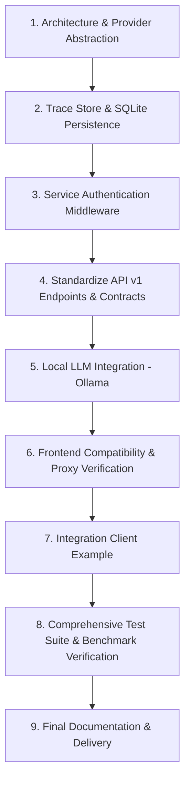

# Phase 2 Engineering Audit: Xcel RAG Platform

**Author:** Senior AI/ML Engineer & Backend Architect  
**Date:** November 2026  
**Project:** Xcel RAG — Multi-Modal RAG Platform for PDF + CSV Data  
**Status:** In Progress — Stabilization & API Standardization  

---

## 1. Executive Summary

This audit assesses the state of the **Xcel RAG** system before applying Phase 2 engineering enhancements. The goal of Phase 2 is to stabilize the service, standardize its REST API contracts under `/api/v1/`, decouple the GenAI service for seamless backend integration, introduce local LLM provider support (Ollama), and ensure persistent diagnostics and authentication.

---

## 2. Existing Architecture Overview

```
                                 ┌───────────────────────────────────┐
                                 │   Frontend / Client Application   │
                                 └─────────────────┬─────────────────┘
                                                   │ HTTP REST (JSON)
                                                   ▼
                                 ┌───────────────────────────────────┐
                                 │       FastAPI Gateway (8000)      │
                                 │   CorsMiddleware & Stage Logger   │
                                 └─────────────────┬─────────────────┘
                                                   │
                         ┌─────────────────────────┴─────────────────────────┐
                         ▼                                                   ▼
              ┌─────────────────────┐                             ┌─────────────────────┐
              │ Document Ingestion  │                             │   Query Pipeline    │
              │   & Vector Store    │                             │  & Hybrid Retrieval │
              └──────────┬──────────┘                             └──────────┬──────────┘
                         │                                                   │
        ┌────────────────┴────────────────┐                 ┌────────────────┴────────────────┐
        ▼                                 ▼                 ▼                                 ▼
┌──────────────┐                  ┌──────────────┐   ┌──────────────┐                  ┌──────────────┐
│ PyMuPDF PDF  │                  │  Pandas CSV  │   │  ChromaDB    │                  │ Structured   │
│ Structure-   │                  │  Schema &    │   │ (3 Vector    │                  │ Pandas       │
│ Aware Parser │                  │  Row Chunks  │   │ Collections) │                  │ Filter Engine│
└───────┬──────┘                  └───────┬──────┘   └──────┬───────┘                  └──────┬───────┘
        │                                 │                 │                                 │
        └────────────────┬────────────────┘                 └────────────────┬────────────────┘
                         ▼                                                   ▼
              ┌─────────────────────┐                             ┌─────────────────────┐
              │   all-MiniLM-L6-v2  │                             │  Modular Reranker   │
              │ Dense Embeddings    │                             │ (Dense+Lexical+Row) │
              └─────────────────────┘                             └──────────┬──────────┘
                                                                             │
                                                                             ▼
                                                                  ┌─────────────────────┐
                                                                  │ LLM Answer Gen      │
                                                                  │ (OpenAI GPT-4o /    │
                                                                  │ Claude 3.5 Sonnet)  │
                                                                  └─────────────────────┘
```

### File Hierarchy
- **Backend Application**: `backend/app/`
  - `main.py`: Entrypoint, CORS, global exception handler.
  - `core/config.py`: Application configuration via Pydantic Settings (`.env`).
  - `core/logging.py`: Structured stage-based logger (`UPLOAD`, `CHUNKING`, `RETRIEVAL`, `QUERY`, `ERROR`).
  - `api/upload.py`: `/upload/pdf`, `/upload/csv`, `/upload/sample/{name}`.
  - `api/query.py`: `/query` endpoint executing retrieval and LLM answer generation.
  - `api/documents.py`: `/documents`, `/documents/{id}`, `/health`.
  - `services/`:
    - `pdf_service.py`: PyMuPDF text & markdown table extraction, heading hierarchy.
    - `chunking_service.py`: Recursive structure-aware section chunking.
    - `csv_service.py`: Pandas dtype detection, schema chunking, row chunking.
    - `structured_data_retriever.py`: Pandas relational & numerical filter (`>`, `<`, `==`).
    - `embedding_service.py`: Sentence-Transformers (`all-MiniLM-L6-v2`).
    - `vector_store.py`: ChromaDB manager (`pdf_documents`, `csv_records`, `csv_schemas`).
    - `retrieval_service.py`: Multi-stage query analyzer and unified retriever.
    - `reranking_service.py`: Lexical overlap, exact match, and structured boost reranker.
    - `openai_service.py`: OpenAI GPT-4o client with multi-turn conversation memory.
    - `claude_service.py`: Anthropic Claude 3.5 Sonnet client.
    - `document_service.py`: Local JSON file registry (`data/processed/registry.json`).
- **Frontend Dashboard**: `frontend/` (React 18, Vite, Lucide-React).
- **Automated Tests**: `tests/` (18 unit, integration, and benchmark tests).

---

## 3. Component Status & Audit Findings

### A. Working Components

| Component | Verification Result | Notes |
|---|---|---|
| **PDF Ingestion** | **Working** | PyMuPDF reliably parses text, table blocks into Markdown, and extracts typography heading levels. |
| **Structure-Aware Chunking** | **Working** | Recursive text splitting maintains page boundaries and heading metadata; tables are kept intact. |
| **CSV Ingestion** | **Working** | Type inference, null counting, and schema summary generation work as expected. Cleaned DataFrames are cached in `data/processed/`. |
| **Vector Storage (ChromaDB)** | **Working** | Three discrete collections (`pdf_documents`, `csv_records`, `csv_schemas`) properly store vectors and metadata. |
| **Dense Embeddings** | **Working** | `all-MiniLM-L6-v2` produces 384-dimensional embeddings locally without external API dependencies. |
| **Numerical Filtering** | **Working** | `PandasStructuredDataRetriever` reliably matches queries like `marks > 90` or `subject == 'DBMS'`. |
| **Re-ranking Layer** | **Working** | Weighted scoring successfully boosts direct keyword and structured matches over pure vector distances. |
| **LLM Synthesis (OpenAI & Claude)** | **Working** | Context formatting with explicit source headers (`SOURCE N | Type: ... | Page / Row: ...`) enforces non-hallucinatory citations. |
| **Unit & Integration Tests** | **Working** | All 18 baseline tests in `tests/` execute and pass in 8.8 seconds. |
| **Frontend Production Build** | **Working** | `cd frontend && npm run build` compiles without errors. |

---

### B. Broken / Fragile Components

| Component | Severity | Description |
|---|---|---|
| **API Pathing & Non-Standard Contracts** | **High** | Endpoints are defined at the root (`/upload/pdf`, `/upload/csv`, `/query`, `/documents`) instead of `/api/v1/`. The upload endpoints are split by file type rather than a unified `/api/v1/documents/upload`. |
| **Query Response Shape Mismatch** | **High** | The current `/query` response does not provide `request_id`, `retrieval_metadata`, or `execution_metrics` as required by the backend integration specification. |
| **Trace Endpoint Non-Existent** | **High** | `GET /api/v1/query/{request_id}/trace` does not exist. Pipeline trace data is currently returned only in the raw query response and discarded thereafter. |
| **Service Authentication Absent** | **High** | There is no API key or token verification mechanism protecting GenAI endpoints from unauthorized internal or external callers. |
| **In-Memory Conversation Memory** | **Medium** | Conversation history is held in `ConversationManager` in an in-memory dictionary. A service restart flushes all chat histories. |
| **Startup Logging Mismatch** | **Low** | In `main.py`, startup logs print "Configured Claude Model" even when `LLM_PROVIDER=openai` is active. |

---

### C. Missing Components for Phase 2

1. **Unified Upload Endpoint**: `POST /api/v1/documents/upload` accepting multipart form uploads for both `.pdf` and `.csv` files.
2. **Unified Document Management**: `GET /api/v1/documents` and `DELETE /api/v1/documents/{document_id}` with comprehensive deletion of vectors, processed CSVs, and registry entries.
3. **Standardized Query Endpoint**: `POST /api/v1/query` adhering to the contract:
   - Input: `query`, `top_k`, `conversation_id`, `scope` (`hybrid`, `pdf`, `csv`).
   - Output: `request_id`, `answer`, `sources`, `retrieval_metadata`, `execution_metrics`, `conversation_id`.
4. **Persistent Diagnostics Store**: SQLite/in-memory persistent store to retain query traces indexed by `request_id` for developer inspection at `GET /api/v1/query/{request_id}/trace` with sensitive prompt sanitization.
5. **Local LLM Provider (Ollama)**: Provider abstraction allowing offline/local execution with Ollama (e.g., `llama3.2`, `mistral`, `deepseek-r1`) without needing cloud API keys.
6. **Backend Integration Client Example**: `integration/backend_client_example.py` demonstrating health check, document upload, query, error handling, and timeout configurations.
7. **Comprehensive Documentation**: `API_DOCUMENTATION.md`, updated `.env.example`, and `PHASE2_TEST_REPORT.md`.

---

## 4. Integration Blockers for External Backend Teams

1. **Direct ChromaDB Coupling Prevention**: The main application backend must not connect to ChromaDB or SQLite directly. The GenAI service must act strictly as a decoupled HTTP microservice.
2. **Missing Token/API Key Validation**: Without an internal service key mechanism (`X-API-Key` or `Bearer`), any caller on the network can manipulate document indexes or consume LLM tokens.
3. **Inconsistent Error Formats**: Some errors return raw 500 strings instead of consistent JSON error bodies (`{"detail": "..."}`).
4. **Different Upload Routes for File Types**: The main backend team would have to write custom client branching (`if file.endswith('.pdf') then POST /upload/pdf else POST /upload/csv`) rather than posting to a single document upload endpoint.

---

## 5. Recommended Execution Order



1. **Step 1: LLM Provider Abstraction**:
   Define `BaseLLMService` interface. Wrap `OpenAIService`, `ClaudeService`, and add `OllamaService` with a factory function `get_llm_service()`.
2. **Step 2: Trace & Conversation Persistence**:
   Implement a lightweight SQLite/persistent store (`TraceStore`) to capture query traces by `request_id` and sanitize prompt secrets.
3. **Step 3: Internal Service Authentication**:
   Add configurable API key security (`SERVICE_API_KEY`) via FastAPI dependency, allowing transparent access for local testing or strict token validation for microservice integration.
4. **Step 4: Standardize API Endpoints**:
   Create `/api/v1/documents/upload`, `/api/v1/documents`, `/api/v1/documents/{id}`, `/api/v1/query`, and `/api/v1/query/{request_id}/trace`. Retain aliases for existing endpoints to ensure zero frontend regression.
5. **Step 5: Local LLM Support (Ollama)**:
   Add `OllamaService` utilizing standard HTTP REST to `http://localhost:11434/api/chat` with configurable model and timeout.
6. **Step 6: Frontend & Backward Compatibility**:
   Ensure existing UI and Vite proxy work with the standardized endpoints.
7. **Step 7: Integration Client Example**:
   Write `integration/backend_client_example.py` with robust exception handling and timeout patterns.
8. **Step 8: Testing & Verification**:
   Expand test suite covering upload, query, trace, auth, Ollama mocking, and persistence across restarts.
9. **Step 9: Documentation**:
   Produce `API_DOCUMENTATION.md`, `PHASE2_TEST_REPORT.md`, updated `.env.example`, and `README.md`.
